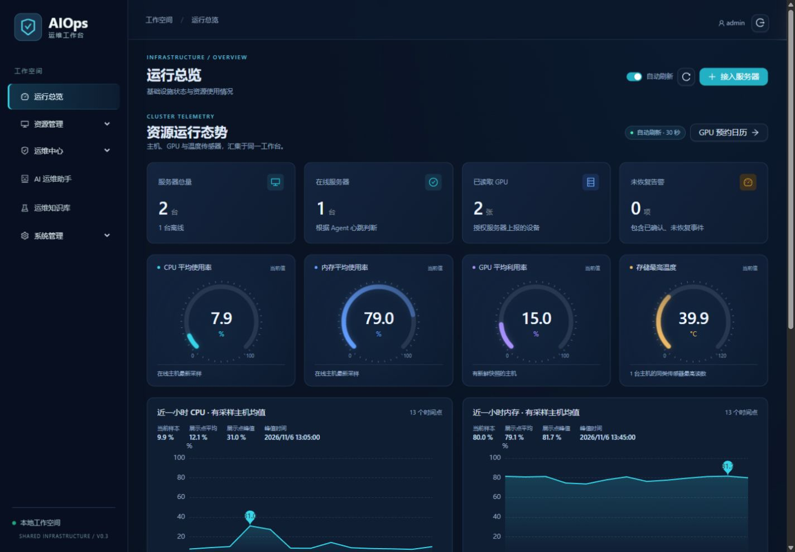
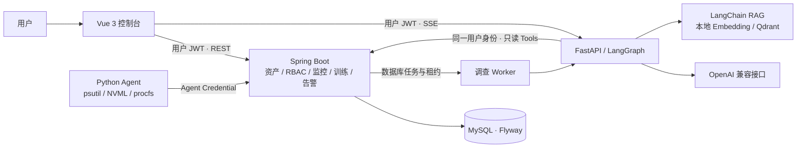

# AIOps Agent Platform

**共享 GPU 训练资源协同与智能运维平台**

[](https://github.com/Zhanghaorenen/aiops/actions/workflows/ci.yml)
[](LICENSE)

面向实验室与小型团队共用 GPU 服务器的场景，提供主机/GPU 监控、训练资源准入、告警调查及带知识库引用的 AI 对话。受管服务器仅运行轻量 Python Agent，模型与管理服务集中部署。

[快速开始](docs/quickstart.md) · [架构设计](docs/architecture.md) · [演示流程](docs/project-demo.md) · [源码与面试讲解](docs/portfolio.md) · [文档索引](docs/README.md)



> 截图为 V0.3 本地联调时的实际界面，展示当时采样，不代表当前实时状态，也不代表 V0.4 已完成真实训练验收。

## 解决的问题

多人共用 GPU 时，显存空闲并不等于整机资源足够：RAM、CPU、磁盘和网络也可能成为瓶颈。平台将资源观测、使用承诺、实际进程与诊断建议关联起来，帮助使用者判断谁在占用资源、任务是否可以接入、训练变慢有哪些证据。

## 功能

| 能力 | 当前实现 |
|---|---|
| 主机 / GPU 遥测 | CPU/各核、RAM/Swap、多分区、网卡、多 GPU、传感器温度与进程；缺测保持未知 |
| 训练资源协同 | SHARED/EXCLUSIVE、整机 RAM 与 GPU 显存联合准入、安全预留、队列复查、生命周期与历史 |
| 进程身份关联 | PID＋启动时间＋Linux 用户，避免 PID 复用误关联；可选 SDK 上报 Epoch/Step/吞吐 |
| 告警与调查 | 预设 / 自定义规则、持续窗口、恢复阈值、去重；告警关联 Incident 后异步调查 |
| AI 运维助手 | LangGraph 调度 LangChain 只读工具，SSE 输出文本与工具状态，查询沿用用户 JWT |
| RAG 知识库 | 模板编辑、文档解析、分块与向量检索、重新索引、原文引用 |
| 共享权限 | ADMIN/OPERATOR/VIEWER；用户 JWT 与独立 Agent Credential 分离 |

**能力边界：** 当前训练采用手动启动与 PID 关联；共享预约是资源承诺，不提供硬件显存隔离。模型没有任意 SSH/Shell 执行能力。整卡 GPU 利用率不归因于单个进程，未知退出码不推断为成功。

## 架构



## 值得阅读的实现

- **联合准入的并发保护：** 先锁服务器行再检查资源承诺；RAM 按整机计算；运行任务不从实际可用量重复扣除估计资源。见 [TrainingJobService](src/main/java/com/aiops/backend/service/TrainingJobService.java)。
- **可追溯进程身份：** 启动时间补足 PID，区分进程退出事实与训练结果。见 [ProcessCollector](agent/aiops_agent/collectors/process.py)。
- **规则与模型分工：** 准入和告警触发由业务代码决定；模型解释工具证据并指出缺失信息。见 [AlertRuleEngine](src/main/java/com/aiops/backend/service/AlertRuleEngine.java) 和 [GraphAgent](agent/ai-service/app/agents/graph_agent.py)。
- **异步调查与授权：** 数据库队列、幂等键和租约；工具调用重新执行权限校验。见 [InvestigationTaskService](src/main/java/com/aiops/backend/service/InvestigationTaskService.java)。

## 快速开始

环境：JDK 17+、Maven Wrapper、Node.js 22.12+（CI 使用 24）、Python 3.10+、MySQL 8。RAG 另需 Qdrant 与本地 Embedding 模型。

```bash
git clone https://github.com/Zhanghaorenen/aiops.git
cd aiops
```

只看界面：在 `frontend` 执行 `npm ci`、`npm run dev`，在登录页选择标明的“演示环境”。示例数据不用于证明监控或训练结果。

完整运行请按 [快速开始](docs/quickstart.md) 配置数据库、JWT 和管理员身份。根目录 [.env.example](.env.example) 集中列出配置；[scripts/run.py](scripts/run.py) 可加载本机 `.env` 分别启动三个开发服务。没有默认管理员密码或模型密钥。

## 仓库结构

```text
src/main/java/com/aiops/backend/   API、业务规则和持久化
src/main/resources/db/migration/  Flyway V1–V13，只追加迁移
src/test/                        Java 测试与隔离配置
agent/aiops_agent/                采集 Agent 与可选训练 SDK
agent/ai-service/app/             FastAPI、LangGraph、Tools、RAG
frontend/src/                    Vue 控制台与流式对话
scripts/                         开发启动与仓库检查
docs/                            当前架构、使用与演示说明
docs/archive/                    历史阶段记录
.github/workflows/               Java / Python / Vue 检查
```

## 验证与完成度

V0.4 已记录的本地自动化结果：Java 129 项、Agent 20 项、Vue 23 项通过；AI 64 项中 63 项通过，外部 Qdrant 专项测试因未配置测试地址跳过。测试包含 H2、模拟 HTTP/传感器和组件检查，不是模型准确率或生产压测结果。本次整理的检查另见 [发布准备记录](docs/release-readiness.md)。

主机/GPU 上报与 V0.3 页面有历史真实联调记录；V0.4 训练功能尚未完成真实 MySQL 迁移、GPU 多用户并发及模型联合验收。子进程树和历史查询存在返回上限。详见 [V0.4 实现说明](docs/v04-training-implementation.md)。CI 状态以 Actions 实际运行结果为准。

```bash
./mvnw test
cd agent && python -m unittest discover -s tests -v
cd ai-service && python -m unittest discover -s tests -v
# 在 frontend 目录执行
npm run typecheck && npm test && npm run build
```

## 参与与许可

提交问题或改进前请阅读 [CONTRIBUTING](CONTRIBUTING.md)。安全问题按 [SECURITY](SECURITY.md) 处理，避免公开凭据、原始日志和私有文档。

本项目采用 [MIT License](LICENSE)。依赖组件及模型权重遵循其自身许可；仓库不分发模型权重、服务器凭据或真实用户数据。
