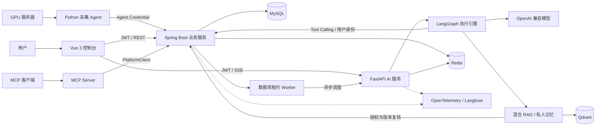
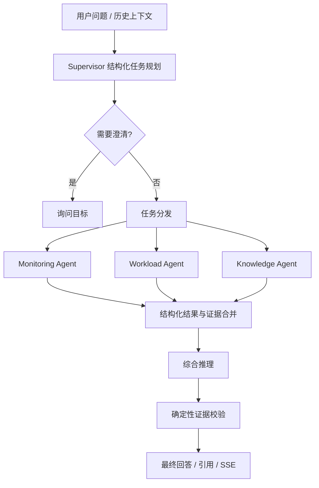
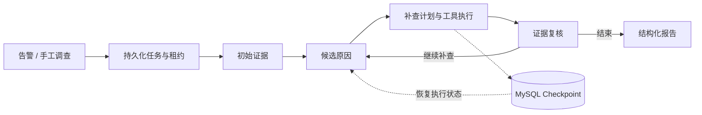
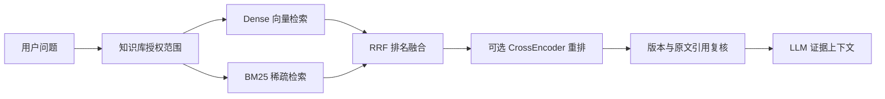

<div align="center">

# AIOps · GPU 智能运维与训练资源协同平台

**基于 LangGraph Multi-Agent 的 GPU 智能运维系统**

面向实验室与研发团队的共享 GPU 环境，融合资源监控、训练准入、自主故障调查、混合 RAG 与长期记忆，构建可观测、可恢复、可追溯的 AI 运维工作流。

[](https://github.com/Zhanghaorenen/aiops/actions/workflows/ci.yml)
[](LICENSE)


[快速体验](#快速体验) · [系统架构](#系统架构) · [核心技术设计](#核心技术设计) · [实验与工程验证](#实验与工程验证)

</div>


> 截图来自历史版本本地联调；当前前端另提供标明的示例数据演示模式，非实时生产数据。

## 项目背景

实验室与小型研发团队通常共享有限的 GPU 服务器。传统的 `nvidia-smi` 和监控面板能够展示资源占用，却难以直接回答下一个任务能否安全接入、训练为何突然变慢、如何结合历史故障与实时指标进行诊断。

| 业务痛点 | 设计方案 |
| --- | --- |
| 显存有余量但整机内存不足，并发预约容易冲突 | GPU 显存与整机 RAM 联合准入、事务并发控制、排队复查 |
| 告警仅描述现象，故障原因涉及多个资源指标 | 确定性告警规则 + LangGraph 自主调查 + 结构化证据报告 |
| 通用 LLM 缺乏实时服务器数据与团队知识 | Tool Calling、Multi-Agent、混合 RAG、长期记忆与证据校验 |

**设计原则：规则负责资源决策与安全边界，Agent 负责信息检索、分析推理与解释，关键结论尽可能回溯到实际工具证据。**

## 系统架构



| 层级 | 技术栈与职责 |
| --- | --- |
| Web 控制台 | Vue 3、TypeScript、Ant Design Vue、SSE |
| AI 应用层 | Python、FastAPI、LangChain、LangGraph、Pydantic、asyncio |
| 检索与模型 | OpenAI 兼容 API、Sentence Transformers、Qdrant、BM25、RRF、CrossEncoder |
| 业务服务 | Java 17、Spring Boot、Spring Security、MyBatis-Plus、JWT / RBAC |
| 基础设施 | MySQL、Flyway、Redis、Docker Compose、OpenTelemetry、可选 Langfuse |
| 采集层 | psutil、NVML、Linux procfs、可选训练 SDK；受管节点无需部署大模型 |

## 核心技术设计

### 01 · LangGraph Multi-Agent 协作与受控工具调用

面向需要同时分析主机状态、训练负载和运维知识的复合问题，在原单 Agent 基础上实现可切换的 Supervisor 架构。



- **任务编排：** Pydantic 约束 TaskPlan；独立子任务通过 asyncio.gather 并发执行，依赖任务顺序执行。
- **工具隔离：** Monitoring、Workload、Knowledge 分别拥有专业工具白名单，共享经认证的 PlatformClient。
- **执行预算：** 单专业 Agent 最多三轮、四次工具调用；共享预算最多十二次，使用 asyncio.Lock 控制并发计数，并对重复调用去重。
- **证据约束：** 区分 observation / hypothesis / recommendation，校验来源、采样时间、引用与冲突证据；证据不足的结论降级为未验证假设。
- **交互与安全：** SSE 展示规划、专业 Agent、工具执行与综合状态；Java 后端重新验证权限，不信任模型声明的角色。

源码：[Multi-Agent](agent/ai-service/app/agents/multi_agent/) · [GraphAgent](agent/ai-service/app/agents/graph_agent.py) · [Chat API](agent/ai-service/app/api/chat.py) · [设计说明](docs/multi-agent-architecture.md)

### 02 · 自主故障调查与可恢复 Agent 工作流

将一次性问答扩展为具备状态、预算和证据约束的异步调查任务。



- 确定性规则结合持续窗口、恢复阈值、冷却和去重触发告警；后台 Worker 异步执行调查。
- 基于幂等键、任务租约、过期回收与 LangGraph Checkpoint 保存状态及 pending writes；恢复时复用已经持久化的证据。
- 真实 MySQL 并发测试发现任务领取 UPDATE 死锁，采用 READ COMMITTED 与单行 `FOR UPDATE SKIP LOCKED` 改造，并通过租约校验阻止失效 Worker 写回。
- 报告保留采样事实、候选解释、反对证据、信息缺口及建议，不直接将模型推测认定为故障根因。

源码：[IncidentGraph](agent/ai-service/app/agents/incident_graph.py) · [Checkpointer](agent/ai-service/app/agents/checkpoint.py) · [InvestigationTaskService](src/main/java/com/aiops/backend/service/InvestigationTaskService.java) · [调查设计](docs/investigation.md)

### 03 · 混合 RAG 与跨会话长期记忆

共享运维知识与用户私人记忆采用独立检索链路，避免混淆实时状态、团队文档与个人偏好。



- **混合检索：** Dense 负责语义匹配，BM25 补足术语与错误码匹配，RRF 融合排名；支持可选重排及检索降级。
- **索引一致性：** MySQL 管理原文、文档版本与状态，Qdrant 存储索引；查询限制授权范围并复核有效版本。
- **长期记忆：** 用户授权后，后台任务提取滚动摘要与结构化记忆，通过主题与语义去重、版本控制和索引 outbox 异步维护。
- **按需召回：** Qdrant Top-K 召回后回查 MySQL 的用户、状态与版本，仅将有效文本注入上下文；召回异常时降级为普通对话。

源码：[RAG](agent/ai-service/app/rag/) · [Memory](agent/ai-service/app/memory/) · [混合检索设计](docs/engineering-upgrade/02-hybrid-retrieval.md) · [长期记忆设计](docs/user-memory.md)

### 04 · GPU 训练资源联合准入与并发一致性

传统单卡预约忽略跨 GPU 共享的整机内存。本项目同时管理整机 RAM、目标 GPU 显存与已承诺资源。

- 支持 SHARED / EXCLUSIVE 模式、安全预留、排队复查、生命周期管理与历史资源画像。
- 同一事务内先锁服务器行再读取资源承诺，防止两个请求同时读取空闲资源并重复预约。
- 运行中任务已反映在实际可用资源中，避免再次扣除其估计峰值；远期预约在启动前重新检查。
- 通过 PID + 启动时间 + Linux 用户关联训练进程，避免 PID 复用误关联；退出码缺失时记录未知结果，而非判定成功。

源码：[TrainingJobService](src/main/java/com/aiops/backend/service/TrainingJobService.java) · [ProcessCollector](agent/aiops_agent/collectors/process.py) · [训练资源设计](docs/training.md)

### 05 · Redis、可观测性与 MCP 工程基础设施

| 工程问题 | 实现机制 |
| --- | --- |
| 高频监控读取 | Redis 短 TTL 快照缓存，采样事务提交后切换缓存代次；异常时回查 MySQL |
| 模型调用限流 | Redis Lua 用户级滑动窗口，普通与 SSE 对话共享额度；Redis 故障时拒绝请求，避免绕过限流 |
| 实时通知 | MySQL 持久化 + AFTER_COMMIT + Redis Pub/Sub + SSE；重连补查，保留轮询兜底 |
| 跨服务调试 | OpenTelemetry Trace 关联 Java、FastAPI、工具、模型、Token、延迟及调查恢复；支持可选 Langfuse 导出 |
| 外部工具复用 | MCP STDIO / Streamable HTTP 暴露六个授权只读工具，复用 PlatformClient 与业务权限校验 |
| 安全与身份 | JWT / RBAC、独立 Agent Credential、服务密钥、任务租约及追踪脱敏 |

技术文档：[Redis](docs/redis.md) · [Tracing](docs/engineering-upgrade/01-tracing.md) · [MCP](docs/engineering-upgrade/04-mcp-server.md) · [资源保护](docs/resource-guard.md)

## 实验与工程验证

以下结果来自仓库记录的本地测试与评测，非生产环境 SLA。

### RAG 检索策略对比

15 个标注查询、10 个模拟知识片段；CPU、本地 bge-small-zh-v1.5 Embedding、可选 mmarco-mMiniLMv2-L12-H384-v1 重排。

| 检索方案 | Recall@5 ↑ | MRR@10 ↑ | nDCG@10 ↑ |
| --- | ---: | ---: | ---: |
| Dense | 0.867 | 0.852 | 0.886 |
| Dense + BM25 + RRF | 0.933 | **0.896** | **0.919** |
| RRF + CrossEncoder | **1.000** | 0.836 | 0.877 |

混合检索相对 Dense 的 Recall@5 提升 6.6 个百分点，nDCG@10 提升 0.033。重排虽提高召回，但排序指标下降且耗时增加，因此保留为可选策略，需针对更大真实语料验证。

### 单 Agent 与 Multi-Agent 对照

使用真实 deepseek-flash 模型、相同的 60 道人工标注场景与模拟工具观测，覆盖 GPU 异常、资源竞争、训练性能、知识检索与复杂故障。

| 指标 | 单 Agent | Multi-Agent | Multi-Agent + 已验证偏好 |
| --- | ---: | ---: | ---: |
| 严格通过率 | 20.0% | 18.3% | 18.3% |
| 必需证据覆盖率 | 65.6% | 55.1% | 51.7% |
| 路由准确率 | — | 55.9% | 61.0% |
| 平均延迟 | 5.95 s | 12.68 s | 12.43 s |

首次实验尚未显示 Multi-Agent 的总体优势。工具 fixture 覆盖不足、严格工具集合匹配及路由误差是后续优化重点；多 Agent 模式保留为可配置选项，而非默认替代单 Agent。

### 回归与故障注入

| 验证项 | 已记录结果 |
| --- | --- |
| Java 回归 | 190 通过 / 4 跳过 |
| Python AI 回归 | 121 通过 / 3 跳过 |
| Multi-Agent、采集端、前端 | 分别 33/33、45/45、28/28 通过 |
| MySQL 并发调查 | 两个 Worker 对同一任务只产生一个有效租约；拒绝旧 token 写回 |
| 进程中断恢复 | 专用 FastAPI 测试进程退出后从已保存节点继续，保留先前证据 |
| 依赖故障与权限 | Redis、Qdrant 故障路径及 MCP 越权拒绝测试；按不同依赖降级或拒绝 |

[完整实验记录与限制](docs/engineering-upgrade/06-final-testing.md) · [评估框架与数据集](evaluation/) · [评估口径](docs/engineering-upgrade/05-llm-evaluation.md) · [CI 工作流](.github/workflows/ci.yml)

## 功能体验

1. 接入 GPU 服务器，查看 CPU、RAM、Swap、磁盘、网络、GPU 与进程遥测。
2. 登记训练任务，检查整机 RAM 与目标 GPU 显存预算，跟踪运行状态及历史画像。
3. 出现异常告警或训练性能问题时，发起 AI 深度调查，查看证据、候选原因与建议。
4. 在 AI 对话中查询授权服务器、训练任务与运维知识，按配置查看专业 Agent 协作过程与 Trace。
5. 上传团队文档建立知识库；在个人记录中管理私人记忆、故障经验及资源通知。

## 快速体验

仅体验前端（无需 GPU、模型或数据库）：

```bash
git clone https://github.com/Zhanghaorenen/aiops.git
cd aiops/frontend
npm ci
npm run dev
```

打开终端显示的地址，在登录页选择「演示环境」。

完整部署需要 JDK 17+、Node.js 22.12+、Python 3.10+、MySQL 8；Redis、Qdrant、Embedding 与模型按功能配置。从根目录参考 [.env.example](.env.example)，按照 [快速开始](docs/quickstart.md) 完成依赖安装、数据库与管理员初始化，再在三个终端分别启动：

```bash
python scripts/run.py backend
python scripts/run.py ai
python scripts/run.py frontend
```

受管服务器采集 Agent 独立部署。Multi-Agent 默认关闭；混合检索、Checkpoint、MCP 等增强能力需按 [工程化配置](docs/engineering-upgrade/README.md) 显式启用。仓库不包含默认管理员密码、真实服务器凭据或模型密钥。

## 代码结构

```text
aiops/
├── agent/
│   ├── aiops_agent/           # 主机/GPU 采集、进程与训练 SDK
│   └── ai-service/app/
│       ├── agents/            # GraphAgent、Supervisor、IncidentGraph
│       ├── tools/             # 监控、训练与知识检索工具
│       ├── rag/               # 文档处理、混合检索与索引
│       ├── memory/            # 摘要提取、索引与记忆召回
│       └── mcp_server/        # MCP 工具服务与授权
├── src/main/java/             # Spring Boot 业务、权限与调查
├── src/main/resources/        # 配置与 Flyway 迁移
├── src/test/                  # Java 回归与并发测试
├── frontend/                  # Vue 3 控制台
├── evaluation/                # Agent 评测数据集、指标及运行器
├── tests/                     # 工程集成验证
├── scripts/                   # 启动与开发工具
└── docs/                      # 架构、部署、演示与实验记录
```

## 当前边界与后续方向

项目定位为面向实验室与小型团队的工程原型，不替代 Kubernetes、Slurm 或成熟 GPU 调度系统。训练由用户手动启动并关联 PID，共享预约属于逻辑资源承诺，不提供硬件隔离。模型不具备任意 SSH / Shell 执行权限；管理员可请求受控资源保护检查，但本地保护默认关闭。

后续重点：完善真实工具场景与 Agent 路由评估、扩大检索语料、完成真实 GPU 多用户长期运行、目标环境 MCP / Langfuse 与生产负载验收。

## 文档与许可

[文档索引](docs/README.md) · [架构与设计取舍](docs/architecture.md) · [演示流程](docs/project-demo.md) · [API 设计](docs/api-design.md) · [工程化升级](docs/engineering-upgrade/README.md)

本项目采用 [MIT License](LICENSE)。依赖组件及模型权重遵循自身许可。贡献与安全问题请参阅 [CONTRIBUTING](CONTRIBUTING.md) 与 [SECURITY](SECURITY.md)。
