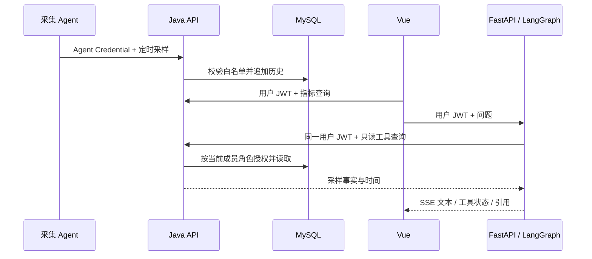

# 架构与设计取舍

## 服务边界

- Vue 3 + TypeScript + Ant Design Vue：资产、仪表盘、训练协同、告警、知识库及 SSE 对话。
- Spring Boot + Spring Security + MyBatis-Plus：用户、工作空间、Agent 身份、物理采样、资源承诺、告警与调查任务。
- FastAPI + LangChain + LangGraph：模型协议适配、有限工具循环、流式事件、知识检索与只读诊断。
- Python Agent：psutil / NVML / Linux 原生接口采样，通过独立凭据定时上报；服务器不部署大模型。
- MySQL 是业务与监控存储，Flyway 负责 V1–V13 演进；Qdrant 只存知识向量，不作为第二套监控库。

## 资源准入

训练任务复用原 `ops_gpu_usage` 的时间、GPU 和用户信息，扩展表保存训练元数据与事件。创建、编辑、重新检查及关键状态转换先锁对应服务器行，再读取已承诺资源，覆盖“空结果也要保护”的并发情况。

近期准入基于实际 Available RAM / Free VRAM；正在运行的任务已经反映在实际可用量中，不再次扣除其估计峰值。远期按容量承诺，启动前重新检查。RAM 跨所有 GPU 汇总，显存在目标 GPU 内汇总。所有相交窗口保守累加，可能拒绝部分可精细错峰安排的组合。

旧时间预约按独占处理；共享模式是软约束，不能阻止用户绕过平台直接运行程序。没有引入 Kubernetes、Slurm 或硬件隔离机制。

## 身份与故障判断

PID 会复用，关联还要求启动时间、Linux 用户与 GPU 一致。管理员维护平台用户与 Linux 用户映射。Agent 确认退出但拿不到退出码时记录 EXITED_UNKNOWN，结果由用户或 SDK 确认；不能仅因 GPU 暂时不活跃认定进程退出。

告警使用确定性规则，包括数据新鲜度、持续窗口、恢复阈值和冷却；人工确认不等于指标恢复。Incident 调查复用数据库队列、请求幂等键及租约，由后台 Worker 调用 FastAPI，诊断报告保存后供人工复核。

## AI 与知识库

模型获得注册的监控工具，以及一个仅管理员可用的资源保护检查请求工具；后者不接受PID或命令，只请求本地规则检查。每次工具调用带用户 JWT 返回 Java 重新授权，不信任模型自己声明的角色。工具循环及结果大小受限，历史对话和检索内容作为不可信数据处理。自动终止只在采集端本地开关、业务UID与持续内存压力规则全部满足时生效，详见[资源保护](resource-guard.md)。

知识库原文件、解析状态与向量索引分开管理；Qdrant 查询带知识库、文档及版本范围约束。回答引用只来自实际检索结果。模型权重、API Key 与知识原文不提交到仓库。

## 当前工程边界

尚无生产规模容量或高可用验证；指标/训练进度保留清理策略、跨模型向量迁移、任务资源硬隔离及任意远程执行均不属于已验收能力。V0.4 的真实 MySQL/GPU/模型联合验收仍待完成，见 [版本说明](training.md)。
