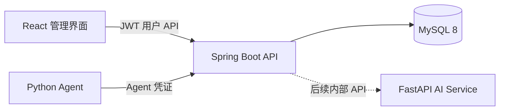
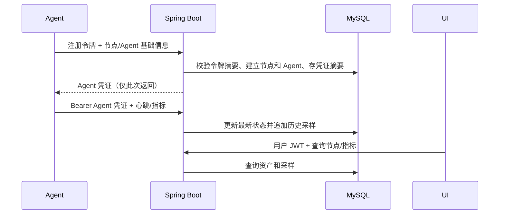

# 总体架构

## 当前工程审查

- 后端：Spring Boot 4.1.1、Java 17、Maven、Spring MVC、Spring Data JPA；持久化默认 MySQL，测试使用 H2。
- 已有 API：健康检查、Agent CRUD/心跳、指标写入/最近/最新、服务器列表/详情、Dashboard 摘要。
- 原型实体仍保留；新增用户、节点资产、Agent 凭证/注册令牌和主机指标实体。
- V0.1 后端基础：Spring Security、BCrypt、JWT、Flyway、独立节点资产和独立 Agent 凭证。
- 缺失：指标保留清理和 Agent 接口速率限制；Python Agent 和前端已有最小实现，仍需真实主机和浏览器联调。
- 当前风险：MySQL 未运行，Flyway 迁移和旧 MySQL 表兼容性尚未做真实数据库验证。
- 此仓库没有 Git 元数据；`D:\documents\ChatGPT\aiops` 目录仅有空 Git 元数据，不是后端源码目录。

## 目标组件及数据流

## 模块边界

- `security`：用户 JWT 解析、密码校验和端点授权。
- `agent`：独立 Agent 凭证过滤器、注册、心跳和指标写入；不复用用户 JWT。
- `node`：服务器资产生命周期与 Agent 实例分离。
- `metric`：追加式历史采样、最新状态查询和输入校验。
- `db/migration`：Flyway 版本化演进；JPA 仅校验映射，不负责生产建表。
- 前端和 Agent 各自独立部署；AI Service 后续仅通过内部 API 调用只读工具。

Spring Boot 4.1.1 保留。持久层沿用现有 JPA，避免在 Boot 4 环境中未经验证引入 MyBatis-Plus Starter；这是对当前代码最小风险的延续方案。

