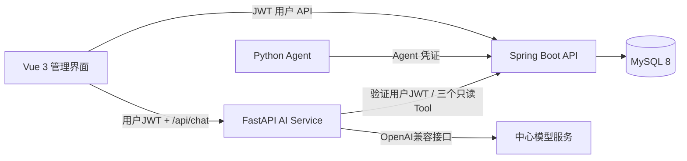
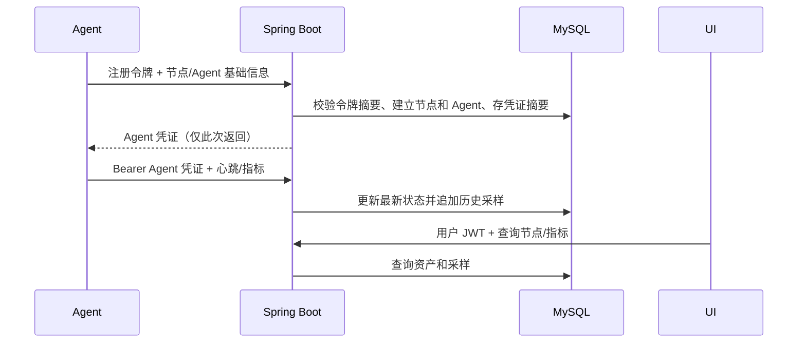

# 总体架构

## 当前工程审查

- 后端：Spring Boot 4.1.1、Java 17、Maven、Spring MVC、MyBatis-Plus 3.5.18；持久化默认 MySQL，测试使用 H2 和相同的 Flyway 迁移。
- 已有 API：健康检查、Agent CRUD/心跳、指标写入/最近/最新、服务器列表/详情、Dashboard 摘要。
- 原型实体仍保留；新增用户、节点资产、Agent 凭证/注册令牌和主机指标实体。
- V0.1 后端基础：Spring Security、BCrypt、JWT、Flyway、独立节点资产和独立 Agent 凭证。
- 缺失：指标保留清理和 Agent 接口速率限制；Python Agent 和前端已有最小实现，仍需真实主机和浏览器联调。
- 阶段 A 已实际启动 MySQL 并验证本机真实采样写入和用户查询；完整证据、限制见 `stage-a-report.md`。
- 实际源码和 Git 仓库位于 `D:\work\aiops\backend`，origin 为 Zhanghaorenen/aiops。

## 目标组件及数据流

## 模块边界

- `security`：用户 JWT 解析、密码校验和端点授权。
- `agent`：独立 Agent 凭证过滤器、注册、心跳和指标写入；不复用用户 JWT。
- `node`：服务器资产生命周期与 Agent 实例分离。
- `metric`：追加式历史采样、最新状态查询和输入校验。
- `db/migration`：Flyway 版本化演进，负责建表；MyBatis-Plus 不自动建表或修改结构。
- `mapper`：MyBatis-Plus `BaseMapper` 和必要的自定义 SQL。
- `repository`：保留业务查询入口，组合 Mapper 完成查询、显式保存和条数限制。
- `persistence`：UTC 时间转换，保证现有 `DATETIME(6)` 数据兼容。
- 前端和 Agent 各自独立部署；AI Service 后续仅通过内部 API 调用只读工具。

Spring Boot 4.1.1 保留，持久层已迁移到专用于 Boot 4 的 MyBatis-Plus Starter。现有表、HTTP 接口和 Flyway V1–V4 保持不变；事务内的对象修改需要显式保存。迁移说明与测试结果见 `mybatis-plus-migration.md`。

