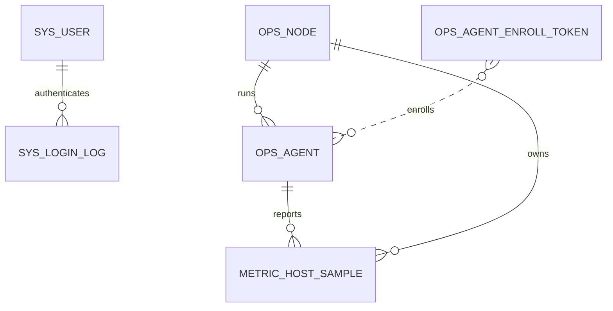

# 数据库设计

所有时间使用 UTC `DATETIME(6)`，应用层以 `Instant` 读写。MySQL 8 / InnoDB / `utf8mb4`。生产 schema 由 Flyway 管理。外键只用于低频资产关系；高频指标按时间索引，后续配置保留与归档策略。当前迁移依次为 V1 用户/登录日志、V2 节点、V3 Agent/注册令牌/主机指标、V4 旧原型表兼容。旧数据不会自动转入新领域表。

## V0.1 逻辑表

| 表 | 用途 / 关键字段 | 约束与索引 |
| --- | --- | --- |
| `sys_user` | `id, username, password_hash, status, created_at, updated_at` | username 唯一；BCrypt 哈希；禁用状态 |
| `sys_login_log` | `id, username, success, remote_ip, created_at` | `(username, created_at)` |
| `ops_node` | `id, node_key, display_name, hostname, ip, os_name, os_version, architecture, cpu_cores, memory_bytes, status, last_seen_at, created_at, updated_at` | node_key 唯一；status/last_seen_at 索引；V2 |
| `ops_agent` | `id, node_id, agent_key, credential_hash, version, status, last_heartbeat_at, created_at, updated_at` | agent_key 唯一；node_id 索引；仅存凭证摘要；V3 |
| `ops_agent_enroll_token` | `id, token_hash, expires_at, used_at, created_at` | token_hash 唯一；不存明文；V3 |
| `metric_host_sample` | `id, node_id, agent_id, cpu_percent, memory_total_bytes, memory_used_bytes, memory_percent, disk_total_bytes, disk_used_bytes, disk_percent, collected_at, received_at` | `(node_id, collected_at, id)`、`(received_at)`；V3 |

唯一约束避免重复身份；指标时间字段区分 Agent 采集时间和服务端接收时间。最新值从历史表按 `(collected_at DESC, id DESC)` 查询，避免重复保存同一业务值。当前 Agent/Metric 表属于早期实现，迁移需保留历史并分步替换旧表，不能让 Hibernate 自动改生产 schema。

## 后续候选表

按功能启用：GPU/磁盘/网络采样、告警规则和事件、容器/日志、任务/审批/执行、模型服务/推理采样、AI 会话/消息/工具调用/诊断、知识库文档/分块、审计日志。大规模日志、向量和时序数据在确有容量需求后迁移专用存储。

