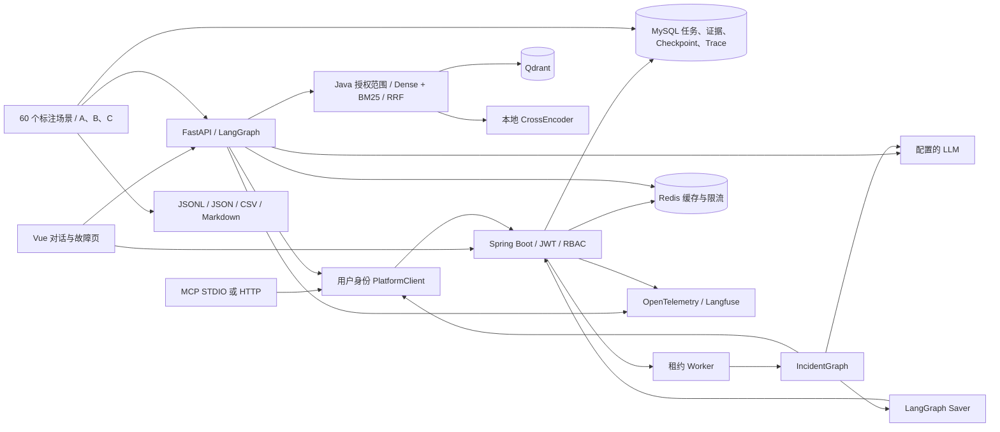

# Agent 工程化升级交付

基于本地 Spring Boot 仓库 `7c3c845` 开发，五项能力均有运行入口。普通聊天、调查任务租约、MySQL 主数据、原 Dense 索引和 Java 授权仍由现有模块负责。新增的业务路径默认关闭，评估由 CLI 显式运行。



## 交付与主要文件

| 能力 | 业务入口与结果 | 主要实现 |
|---|---|---|
| Trace | 对话完成可展开追踪。故障页按 Trace ID 检索本人记录。调查中断后可关联前后两次执行。真实 HTTP、节点、模型、工具、token、错误和耗时均有来源。 | Python `app/telemetry.py`、`trace_export.py`、`llm/client.py`、`api/chat.py`、`api/investigation.py`；Java `InvestigationTrace`、`RequestTraceController`；Vue `TraceViewer.vue`、`InvestigationReport.vue` |
| 检索 | 知识库查询和 Agent 的 search_knowledge 使用同一入口。Java 复核 KB、READY 文档、版本和所有权，知识页可展开排名。 | `rag/vector_store.py`、`hybrid.py`、`rebuild_sparse_index.py`、`retrieval_service.py`、`KnowledgeView.vue` |
| 恢复 | 同一调查运行主键作为 thread_id。MySQL 对同一事务中的 checkpoint 和 pending writes 执行租约校验，训练任务 ID 不参与线程划分。 | `agents/checkpoint.py`、`incident_graph.py`、`InvestigationWorker`、`InvestigationTaskService`、`InvestigationCheckpointService`、`CheckpointController` |
| MCP | 六个只读工具复用 PlatformClient。两种传输入口都按实际用户访问 Java，审计记录工具、关联 ID、状态和耗时。 | `app/mcp_server/server.py`、`auth.py` |
| 模型评估 | 使用共同场景运行原图、Supervisor、Supervisor + 已验证偏好；输出逐题结果、确定性指标、可选 Judge、模型及语料版本。 | `evaluation/datasets/`、`fixtures.py`、`dataset_loader.py`、`runner.py`、`metrics.py`、`judge.py`、`report.py`、`configs/evaluation.yaml` |

## 存储、依赖与接口

| 迁移 | 变更 |
|---|---|
| V19 | 调查运行表新增 W3C 父上下文及索引 |
| V20 | 新增 `ops_graph_checkpoint`、`ops_graph_write`。运行表增加恢复次数、报告追踪 ID 及索引 |
| V21 | `ops_evaluation_run` 保存各模式汇总，逐题回答和工具详情存 JSONL |
| V22 | `ops_request_trace` 按认证用户、Trace ID 和执行 UUID 存脱敏时间线，保留 7 天 |

Redis 沿用原有数据结构和部署配置。本地 Compose 关闭了 AOF 和 RDB，MySQL 可在同一事务中校验任务所有权和保存节点，因此本次采用 MySQL Checkpointer。Qdrant 在原集合旁增加版本化 BM25 集合。Java 新增 OpenTelemetry API，运行跨服务追踪时挂载官方 Java agent。Python 可选依赖集中在 `requirements-engineering.txt`，包括 OpenTelemetry SDK、OTLP HTTP 导出器、Python MCP SDK、PyMySQL、PyYAML。重排复用原 sentence-transformers。

| 接口 | 访问条件与作用 |
|---|---|
| GET /api/ai/traces/{traceId} | 已登录用户读取自己的执行时间线 |
| POST /api/ai/traces | 用户 JWT 和 AI 服务密钥，写入字段受限的时间线 |
| GET /api/investigation-traces/{traceId} | 根据当前用户和事件权限定位关联 Incident |
| GET、POST /api/investigation-tasks/{id}/checkpoint | 当前用户、服务器调查权限、服务密钥和有效租约。读写原生 checkpoint、metadata、pending writes |
| /mcp | 单独进程的 Streamable HTTP 路径，提供工具目录及六个只读工具；STDIO 使用相同目录 |

## 启动和配置

以下命令从后端仓库根目录执行，沿用 quickstart 中的 Java、MySQL、JWT 和模型设置。Flyway 在后端启动时应用新增迁移。三个服务命令分别在独立终端执行。

```powershell
$py = (Resolve-Path agent/.venv/Scripts/python.exe).Path
& $py -m pip install -r agent/ai-service/requirements-engineering.txt
& $py scripts/run.py backend
& $py scripts/run.py ai
& $py scripts/run.py frontend
```

| 功能 | 环境与用法 |
|---|---|
| Trace | Java、Python 设置 `OTEL_ENABLED=true`，分别指定 `OTEL_SERVICE_NAME`。Java 加 `JAVA_TOOL_OPTIONS=-javaagent:/path/opentelemetry-javaagent.jar`。设置 `OTEL_EXPORTER_OTLP_ENDPOINT` 为 collector 基址。启用 Langfuse 时配置 `LANGFUSE_ENABLED`、`LANGFUSE_HOST`、`LANGFUSE_PUBLIC_KEY`、`LANGFUSE_SECRET_KEY`。时间线存储复用已有 `AIOPS_AI_SERVICE_KEY`。部署版本可设 `AIOPS_PROMPT_VERSION`。 |
| Hybrid | `AIOPS_HYBRID_ENABLED=true`，设置 `PYTHONPATH=agent/ai-service`，执行 `python -m app.rag.rebuild_sparse_index --cursor data/sparse-cursor.json`。重排需设置 `AIOPS_RERANKER_ENABLED=true`、`AIOPS_RERANKER_PATH`、`AIOPS_RERANKER_DEVICE=cpu`。 |
| Checkpoint | Java、Python 同时设置 `AIOPS_CHECKPOINT_ENABLED=true` 后重启。保留期用 Spring 属性 `aiops.checkpoint.success-days` 和 `aiops.checkpoint.failure-days` 调整。 |
| MCP | 设置 `AIOPS_MCP_ENABLED=true`、`PYTHONPATH=agent/ai-service` 和既有 `AIOPS_BACKEND_URL`。STDIO 由客户端私下提供 `AIOPS_MCP_USER_JWT`。HTTP 的端口、issuer、JWKS、资源地址和用户委托文件分别由 `AIOPS_MCP_PORT/ISSUER/JWKS/RESOURCE/DELEGATIONS` 指定。 |
| Evaluation | `python -m evaluation.runner --config evaluation/configs/evaluation.yaml`。可加 `--modes A B C --embedding local --rag hybrid --judge`。MySQL 写入需 `--mysql` 和 `AIOPS_EVAL_DB_HOST/PORT/NAME/USER/PASSWORD`。仅模拟评估可通过 `--trace-content` 或 `AIOPS_EVAL_TRACE_CONTENT` 向已配置的 Langfuse 附加有界、脱敏内容。 |

原始模型成绩、故障注入、安全与性能结果见 [集中验证](06-final-testing.md)。各能力的独立部署细节见 [追踪](01-tracing.md)、[混合检索](02-hybrid-retrieval.md)、[恢复](03-checkpoint-recovery.md)、[MCP 客户端配置](04-mcp-server.md) 和 [评估口径](05-llm-evaluation.md)。

## 本次文件清单

<details><summary>配置与依赖（5）</summary>

- 修改 `.env.example`
- 修改 `agent/ai-service/.env.example`
- 修改 `pom.xml`
- 修改 `src/main/resources/application.properties`
- 新增 `agent/ai-service/requirements-engineering.txt`

</details>

<details><summary>测试与 CI（11）</summary>

- 修改 `.github/workflows/ci.yml`
- 修改 `frontend/tests/chat.test.mjs`
- 新增 `src/test/java/com/aiops/backend/EngineeringRecoveryTests.java`
- 新增 `tests/engineering/benchmark_retrieval.py`
- 新增 `tests/engineering/infrastructure.py`
- 新增 `tests/engineering/knowledge_canary.py`
- 新增 `tests/engineering/mcp_stdio_client.py`
- 新增 `tests/engineering/scenario_client.py`
- 新增 `tests/engineering/test_engineering.py`
- 新增 `tests/engineering/test_otlp.py`
- 新增 `tests/engineering/worker_fixture.py`

</details>

<details><summary>追踪与业务接入（25）</summary>

- 修改 `agent/ai-service/app/agents/graph_agent.py`
- 修改 `agent/ai-service/app/agents/multi_agent/graph.py`
- 修改 `agent/ai-service/app/agents/multi_agent/supervisor.py`
- 修改 `agent/ai-service/app/agents/session_turn.py`
- 修改 `agent/ai-service/app/api/chat.py`
- 修改 `agent/ai-service/app/api/investigation.py`
- 修改 `agent/ai-service/app/client/platform_client.py`
- 修改 `agent/ai-service/app/llm/client.py`
- 修改 `agent/ai-service/app/main.py`
- 修改 `agent/ai-service/app/redis_support.py`
- 修改 `frontend/src/api.ts`
- 修改 `frontend/src/components/InvestigationReport.vue`
- 修改 `frontend/src/composables/useAiChat.ts`
- 修改 `frontend/src/views/AiChatView.vue`
- 修改 `frontend/src/views/IncidentsView.vue`
- 修改 `src/main/java/com/aiops/backend/controller/IncidentController.java`
- 修改 `src/main/java/com/aiops/backend/security/JwtAuthenticationFilter.java`
- 修改 `src/main/java/com/aiops/backend/service/IncidentService.java`
- 新增 `agent/ai-service/app/telemetry.py`
- 新增 `agent/ai-service/app/trace_export.py`
- 新增 `frontend/src/components/TraceViewer.vue`
- 新增 `src/main/java/com/aiops/backend/controller/RequestTraceController.java`
- 新增 `src/main/java/com/aiops/backend/service/InvestigationTrace.java`
- 新增 `src/main/resources/db/migration/V19__investigation_trace.sql`
- 新增 `src/main/resources/db/migration/V22__request_trace.sql`

</details>

<details><summary>节点恢复与追踪（7）</summary>

- 修改 `agent/ai-service/app/agents/incident_graph.py`
- 修改 `src/main/java/com/aiops/backend/service/InvestigationTaskService.java`
- 修改 `src/main/java/com/aiops/backend/service/InvestigationWorker.java`
- 新增 `agent/ai-service/app/agents/checkpoint.py`
- 新增 `src/main/java/com/aiops/backend/controller/CheckpointController.java`
- 新增 `src/main/java/com/aiops/backend/service/InvestigationCheckpointService.java`
- 新增 `src/main/resources/db/migration/V20__investigation_checkpoints.sql`

</details>

<details><summary>混合检索（6）</summary>

- 修改 `agent/ai-service/app/rag/retrieval_service.py`
- 修改 `agent/ai-service/app/rag/schemas.py`
- 修改 `agent/ai-service/app/rag/vector_store.py`
- 修改 `frontend/src/views/KnowledgeView.vue`
- 新增 `agent/ai-service/app/rag/hybrid.py`
- 新增 `agent/ai-service/app/rag/rebuild_sparse_index.py`

</details>

<details><summary>文档（10）</summary>

- 修改 `docs/architecture.md`
- 修改 `docs/quickstart.md`
- 新增 `docs/engineering-upgrade/01-tracing.md`
- 新增 `docs/engineering-upgrade/02-hybrid-retrieval.md`
- 新增 `docs/engineering-upgrade/03-checkpoint-recovery.md`
- 新增 `docs/engineering-upgrade/04-mcp-server.md`
- 新增 `docs/engineering-upgrade/05-llm-evaluation.md`
- 新增 `docs/engineering-upgrade/06-final-testing.md`
- 新增 `docs/engineering-upgrade/PROGRESS.md`
- 新增 `docs/engineering-upgrade/README.md`

</details>

<details><summary>MCP（3）</summary>

- 新增 `agent/ai-service/app/mcp_server/__init__.py`
- 新增 `agent/ai-service/app/mcp_server/auth.py`
- 新增 `agent/ai-service/app/mcp_server/server.py`

</details>

<details><summary>模型评估（14）</summary>

- 新增 `evaluation/__init__.py`
- 新增 `evaluation/configs/evaluation.yaml`
- 新增 `evaluation/dataset_loader.py`
- 新增 `evaluation/datasets/complex_incident.jsonl`
- 新增 `evaluation/datasets/gpu_anomaly.jsonl`
- 新增 `evaluation/datasets/rag_retrieval.jsonl`
- 新增 `evaluation/datasets/training_degradation.jsonl`
- 新增 `evaluation/datasets/workload_contention.jsonl`
- 新增 `evaluation/fixtures.py`
- 新增 `evaluation/judge.py`
- 新增 `evaluation/metrics.py`
- 新增 `evaluation/report.py`
- 新增 `evaluation/runner.py`
- 新增 `src/main/resources/db/migration/V21__evaluation_runs.sql`

</details>
