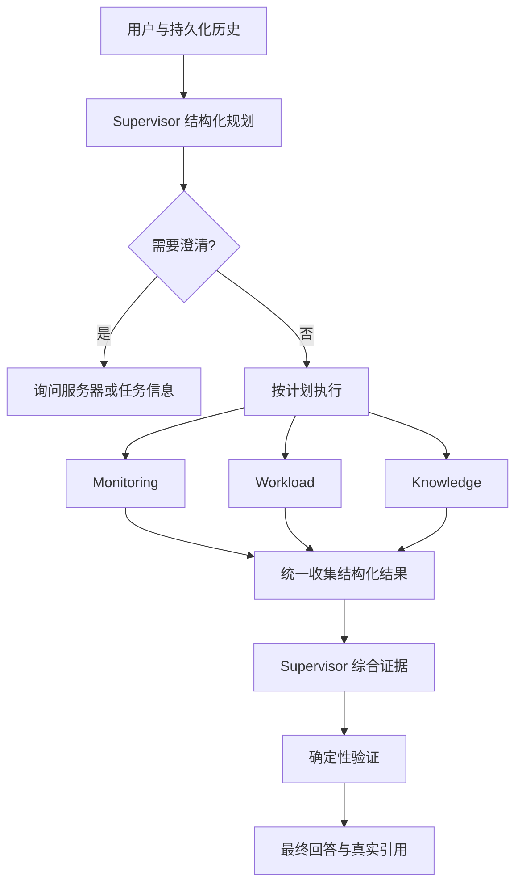

# Multi-Agent 第一版

新增文件清单位于 app/agents/multi_agent 下，包括 __init__.py、supervisor.py、graph.py、state.py、schemas.py、router.py、result_merger.py、evidence_validator.py、budget.py、events.py，agents 下的 __init__.py、base.py、monitoring_agent.py、workload_agent.py、knowledge_agent.py，以及 prompts 下四份独立提示词。新增测试为 tests/agents/multi_agent 下的 test_foundation.py、test_multi_agent.py、test_api.py 和 demo.py。

修改文件包括 app/agents/graph_agent.py、app/api/chat.py、app/config.py、app/tools/server_tool.py、app/tools/gpu_tool.py、两份 .env.example 和 .github/workflows/ci.yml。GraphAgent 新增可选单实例工具预算和成功调用去重参数，默认值保持现有行为。工具事件可携带专业 Agent 名称。

通过 `AIOPS_MULTI_AGENT_ENABLED` 选择 Supervisor 与三个专业 Agent。默认 false 继续使用 GraphAgent，现有普通聊天、IncidentGraph、JWT/RBAC、限流与会话协议沿用。无需新增依赖或数据库迁移。



Supervisor 规划与综合，不注册底层查询工具。目标明确时重新经过当前用户 PlatformClient 核权。目标缺失时读取可访问服务器列表，只有一台时选定，多台时澄清。规划由 LLM 返回 TaskPlan，Pydantic 校验领域、数量、任务预算及字段。专业 Agent 每种最多一个。列表查询可以保持目标为空。

Monitoring 白名单为 `list_servers/get_server_status/get_server_resource_usage/list_gpus/get_gpu_status/get_gpu_overview/get_gpu_processes/get_gpu_history/get_recent_gpu_history/analyze_gpu_health/compare_gpu_load`。

Workload 白名单为 `list_training_jobs/analyze_training_contention/get_active_workloads/analyze_active_workload/get_resource_presets/get_workload_profile/estimate_available_capacity/predict_workload_completion/get_resource_guard_status/recommend_gpu_placement`。

Knowledge 白名单为 `search_knowledge/search_similar_incidents`。三个 Agent 分别加载 prompts 下独立提示词，工具实现复用现有 ServerTool/GpuTool/RagTool。工具名、必填字段和严格参数类型继续由 GraphAgent 校验。任务级服务器、GPU、运行范围额外校验。认证凭据由 API 管理的共享 PlatformClient 持有，专业 Agent 不创建身份或关闭客户端。

`get_private_memories` 与 `request_resource_relief` 均不在白名单。私人偏好通过现有按需、核权后的 UserMemoryRecall 提供受限参考。实时状态始终依赖工具。401/403 传播到原 API 的安全处理路径。

SupervisorState 包含 request_id、question、history、plan、intent、execution_mode、agent_results、evidence_index、final_answer、status、events、errors、tool_calls_total。凭据不放入 State。每次调用使用独立执行作用域，结果由单一节点收集后写入，避免并发字典覆盖。

AgentTask 指定领域、目标、任务范围与 1–4 次工具预算。AgentResult 包含状态 success/partial/failed/skipped、摘要、Finding、EvidenceItem、局限、调用次数、耗时与错误码。EvidenceItem 由执行器生成 UUID，包含来源 Agent/工具、类别、真实采样时间、状态、数据和局限。Finding 区分 observation/hypothesis/recommendation，保存支持与反对引用。

独立任务使用 asyncio.gather 并行，最多三个 Agent。顺序任务将前序结构化结果放入后续上下文。各 Agent 使用 GraphAgent 原有工具节点，最多三轮、四次调用，成功或失败的相同参数只执行一次。共享预算通过 asyncio.Lock 最多接受十二次工具调用，目标发现占用同一预算。单 Agent 时间使用剩余请求预算的 65%，为综合与验证保留时间。整个请求使用既有 chat_timeout，断连取消时回收子任务。

工具结果复用 GraphAgent 大小上限。过大结果保留不可用标记，要求缩小查询。综合上下文上限约 44000 字符，省略正文时明确标记。相同来源、时间、状态和数据通过哈希去重。观察必须引用新鲜监控证据，REFERENCE 只用于知识参考。无效来源、伪造引用、过期时间、未知状态和同源冲突使结论变成带明确“未验证”提示的假设。文本语义和根因因果性仍需人工确认。

/api/chat 与 /api/chat/stream 的请求、响应结构不变，API 工厂按开关调用 Supervisor 或 GraphAgent。session_turn 继续负责幂等、历史恢复及最终回答保存。内部专业草稿不输出为用户 token，不作为对话内容持久化。

SSE 保留 tool_start、tool_end、sources、resource_result、token、done、error，并增加 plan、agent_start、agent_result、synthesis。工具事件带 agent 字段，引用和资源数据保持原协议。最终 token 来自经过确定性校验的综合结果。done/error 仍由原 API 请求层发送。

PowerShell 本地配置和启动：

```powershell
$env:AIOPS_MULTI_AGENT_ENABLED='true'
agent/.venv/Scripts/python.exe scripts/run.py ai
```

需要先提供项目原有 LLM、Java 地址、RAG、Redis 配置和认证用户。使用已有脚本分别启动 backend、frontend。改为 false 并重启 AI 服务可回到 GraphAgent。开关支持环境变量或原有 .env 配置方式。

测试方法：

```powershell
$env:PYTHONPATH='agent/ai-service;agent/ai-service/tests'
agent/.venv/Scripts/python.exe -m unittest discover -s tests/agents/multi_agent -v
agent/.venv/Scripts/python.exe -m unittest discover -s agent/ai-service/tests -v
agent/.venv/Scripts/python.exe -m compileall -q agent/ai-service/app
```

CI 同时运行新测试和现有 Python 检查。GPU 训练异常示例可运行 tests/agents/multi_agent/demo.py。该示例使用明确标注的 Mock 模型与工具，按实际返回数据生成执行器证据 ID 与综合结果。真实模型路由质量需要单独实测。第一版不包含自由讨论、动态创建 Agent、跨请求结果缓存和新的进程管理能力。
