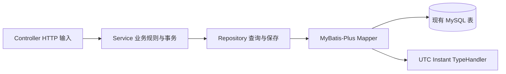

# JPA → MyBatis-Plus 迁移与源码学习指南

## 迁移范围

保留 Spring Boot 4.1.1、Java 17、MySQL、Spring Security、JWT、Flyway，以及现有 Vue/Python 调用协议。生产数据库仍使用原来的八张业务表，不新建第二套监控存储，不搬迁或删除已有数据。

依赖采用 `com.baomidou:mybatis-plus-spring-boot4-starter:3.5.18`，移除 `spring-boot-starter-data-jpa`、JPA 注解及 Spring Data 分页依赖。选择专用 Boot 4 Starter 的依据是 [MyBatis-Plus 官方安装说明](https://baomidou.com/getting-started/install/)。

## 文件与调用关系

| 文件或目录 | 作用 |
| --- | --- |
| `pom.xml` | MyBatis-Plus Boot 4 依赖，版本统一管理 |
| `src/main/resources/application.properties` | Mapper 驼峰映射、UTC Handler 注册、STATEMENT 级缓存；保留环境变量配置 |
| `src/main/java/com/aiops/backend/Entity/*Entity.java` | 八个已有表的字段与自增主键映射；Java 包名仍为 `entity` |
| `src/main/java/com/aiops/backend/mapper` | `@Mapper` 接口继承 `BaseMapper`，通用 CRUD 与必要 SQL |
| `src/main/java/com/aiops/backend/repository` | 保留业务查询入口，内部调用 Mapper；不再继承 JpaRepository |
| `src/main/java/com/aiops/backend/persistence/UtcInstantTypeHandler.java` | Instant 与 UTC DATETIME(6) 双向转换 |
| `service/AuthService.java` | 修改密码后显式保存 |
| `service/AgentAccessService.java` | 令牌消耗、凭证轮换、心跳、指标写入和离线标记均显式保存，保留事务 |
| `service/impl/MetricServiceImpl.java` | 旧监控接口改用有上限的 int 查询条数 |
| `controller/ServerMetricController.java` | 历史接口保留参数与返回值，去掉 Spring Data PageRequest |
| `src/test/resources/application.properties` | H2 运行原 Flyway V1–V4，避免依赖 Hibernate 自动建表 |
| `src/test/java/com/aiops/backend/persistence/AgentAccessPersistenceTests.java` | 8 项：令牌、凭证轮换、心跳、离线、回滚及截止时间边界 |
| `src/test/java/com/aiops/backend/persistence/AuthPersistenceTests.java` | 4 项：显式保存、改密、拒绝变更及失败登录审计 |
| `src/test/java/com/aiops/backend/persistence/MetricPersistenceTests.java` | 8 项：UTC 微秒、空 GPU、历史排序/限额/节点隔离及纳秒查询边界 |
| `src/test/java/com/aiops/backend/persistence/RepositorySaveTests.java` | 1 项：重复保存相同值及保存已删除记录的行为 |
| `AuthFlowTests/MetricControllerTests/MonitoringAccessTests` | 原安全和 HTTP 契约测试改用实际 SQL 持久化，不依赖 EntityManager/flush |
| `service/AgentServiceImplTests.java` | 创建时间与数据库实际 DATETIME(6) 值比较，验证更新不改写创建时间 |
| `README.md`、`docs/architecture.md`、`docs/development.md`、`docs/stage-a-source-guide.md` | 当前依赖、结构、运行方式及学习说明同步 |

没有删除业务实体、历史查询、GPU 原型字段或认证接口。`UserEntity.email` 仍未持久化，使用 `@TableField(exist = false)`，不擅自添加数据库列。



## 与 JPA 的关键差异

JPA 的持久化上下文可能在事务提交时自动检测对象字段变更；MyBatis-Plus 执行 SQL 后返回普通 Java 对象。调用 `agent.heartbeat()`、`token.markUsed()` 或 `user.setPasswordHash()` 只改变内存，必须继续调用对应 Repository 的 `save()`。

Spring 的 `@Transactional` 继续控制多个 SQL 的原子提交和回滚。注册令牌查询保留 `SELECT … FOR UPDATE`，必须在注册事务内执行；注册失败时令牌消耗、节点和凭证的修改一同回滚。不要把行锁查询从事务中拆出。

`BaseMapper.insert()` 将数据库生成的 ID 回填到实体；`updateById()` 根据主键更新。Repository 为已有 Service 保留 `save()` 入口，根据 ID 是否为空选择插入或更新。更新返回 0 行时再核对记录是否存在，兼容 MySQL `useAffectedRows=true` 下重复保存相同值的行为。MyBatis 一级缓存设为 `STATEMENT`，防止同一事务内用户被禁用或凭证轮换后读到旧状态。

所有历史查询保持原来的服务器过滤、时间范围、排序及最大条数。查询参数通过 MyBatis 绑定；不要把用户提供的排序、列名或 SQL 文本拼接进查询。

## 时间与数据库

Flyway V1–V4 不修改，不增加迁移版本。MyBatis-Plus 不自动建表，也不提供原来 Hibernate `ddl-auto=validate` 的全表校验，部署时需保证 Flyway 正常完成。已有数据库无需重建；对既有 Flyway 历史使用原配置继续启动即可。

现有 `DATETIME(6)` 按 UTC 保存。`UtcInstantTypeHandler.setNonNullParameter()` 输入 Instant，截断至微秒后按 UTC 绑定 LocalDateTime；三个 `getNullableResult()` 重载从 JDBC 读取 LocalDateTime，返回 UTC Instant 或 null。这样不会因 JVM/连接会话时区改变而将历史数据偏移八小时。

历史查询的 `>= from` 和离线筛选的 `< cutoff` 使用 `ceilingToMicros()` 向上规范化参数，`<= to` 向下规范化，保证 HTTP 请求包含纳秒时也不扩大或缩小实际查询窗口。

`created_at` 不参与更新；允许为空的列需明确更新策略，防止将 GPU 值设为 null 时被框架默认的非空策略忽略。

## 初学者阅读顺序

1. 从 `src/main/resources/db/migration` 看原表、字段、外键与索引。
2. 看 `UserEntity`、`NodeEntity`、`HostMetricSampleEntity` 的 `@TableName`、`@TableId`、`@TableField`。
3. 看对应 Mapper，理解继承 BaseMapper 就能获得通用查询与写入方法。
4. 看对应 Repository：`findById(id)` 返回 Optional；`save(entity)` 执行插入/更新并返回实体；历史查询输入节点、起止时间和条数，输出有序 List。
5. 看 `AuthService.changePassword()`：查用户 → 验证旧密码 → BCrypt 编码 → 改字段 → 保存。
6. 看 `AgentAccessService.enroll()`：锁注册令牌 → 验证 → 消耗 → 查找/建立节点 → 建立/轮换 Agent 凭证 → 标记在线 → 返回 ID 和一次性明文凭证。
7. 看 `recordMetric()`：校验输入 → 更新心跳 → 保存真实采样。这里不会调用模型或采集 Java 服务所在机器。
8. 看 `ServerMetricController.history()` → HostMetricSampleRepository → Mapper，理解 HTTP 查询如何变为数据库查询。
9. 看 `UtcInstantTypeHandler`，理解 MySQL 无时区 DATETIME 和 Java Instant 的区别。
10. 运行持久化测试并对照 SQL 断言；测试通过不代表真实 LLM 已配置或阶段 B/C/D 已完成。

相关知识点：依赖注入、Mapper 代理、BaseMapper、参数绑定、查询 Wrapper、自动主键回填、Spring JDBC 事务、悲观行锁、事务回滚、字段空值更新策略和 UTC 时间序列。

## 启动与验证

启动方式仍为 `start-local.ps1` 或 `mvnw.cmd spring-boot:run`。MySQL 密码、JWT 密钥继续从环境变量读取，已有管理员密码不会被改写。Vue 与 Python 服务无需改 API。

常规自动化回归：

```powershell
.\mvnw.cmd clean test
```

测试使用 H2 MySQL 兼容模式，并运行真正的 Flyway 迁移；真实 MySQL 验证结果另记于下面，不能由 H2 通过推断。

## 本次实际验证结果

2026-10-27 实际执行结果：

| 检查 | 结果 |
| --- | --- |
| `mvnw.cmd -o clean test`，H2 + 原 Flyway V1–V4 | 57 项，失败 0、错误 0、跳过 0 |
| 同一套测试，真实 MySQL 8.0 独立测试库 | 57 项，失败 0、错误 0、跳过 0 |
| MySQL 特殊连接参数 | 最终全套使用 `useAffectedRows=true`，验证相同值 UPDATE 返回 0 仍能正确保存 |
| 原 `aiops` 数据库前后核对 | 用户 1、节点 1、正式 Agent 1、主机样本 1、旧 Agent 2、旧指标 0；原采集时间和 CPU 值未改变 |
| 临时 MySQL 测试库 | 本次创建，运行完成后已删除；没有新增生产存储 |
| 源码依赖扫描 | `pom.xml` 和 `src/` 无 JPA ORM / Spring Data 使用 |
| 可执行 JAR 打包 | `package -DskipTests` 成功；JAR 包含 MyBatis-Plus 3.5.18、MyBatis 3.5.19、MyBatis-Spring 4.1.0，无 Hibernate ORM/JPA 依赖 |
| 原数据库启动 | 实际启动打包后的应用，Flyway V4 已是最新，无新迁移；`GET /api/health` 返回 UP |
| 原数据库 HTTP 冒烟 | 原管理员登录、`/api/auth/me`、服务器列表/详情/最新指标/历史查询成功；无效 JWT 返回 401 |
| 原样本兼容 | CPU 12.50%，采集时间 `2026-10-27T06:58:22.029649Z`，与迁移前原始 MySQL 值一致 |
| `git diff --check` | 通过 |

新增 21 项持久化测试，保留并适配原有 36 项后端回归。初次运行发现旧测试比较内存纳秒时间与数据库微秒时间，已改为核对数据库实际创建时间，之后完整重跑通过。

Maven Central 在当前网络超时；下载时使用 `data/local-run/mybatis-maven-settings.xml` 临时镜像配置，未修改用户全局设置，也未将镜像写入 POM。后续离线验证使用已下载依赖。日志、H2 与 MySQL 的独立 XML 报告保留在被 Git 忽略的 `data/local-run/`。

迁移后后端已在 `http://localhost:8080` 启动，日志为 `data/local-run/mybatis-backend.log`。此次为健康检查和原库 API 冒烟启动后端，未另外启动前端或 AI 服务。验证登录会正常增加登录审计记录；没有修改原用户密码或原监控采样。新启动进程使用随机开发 JWT 密钥，浏览器原登录态需重新登录。

本次没有改动 Vue 或 Python 的协议与功能，因此未重复运行其构建测试。未进行生产环境部署、高并发压力测试或真实 LLM 验收；阶段 B/C/D 仍未开发。没有新增或变更公开 HTTP API，也没有新数据库迁移或需要手动搬迁数据的步骤。用户继续提供原有数据库连接和 JWT 环境变量即可。
