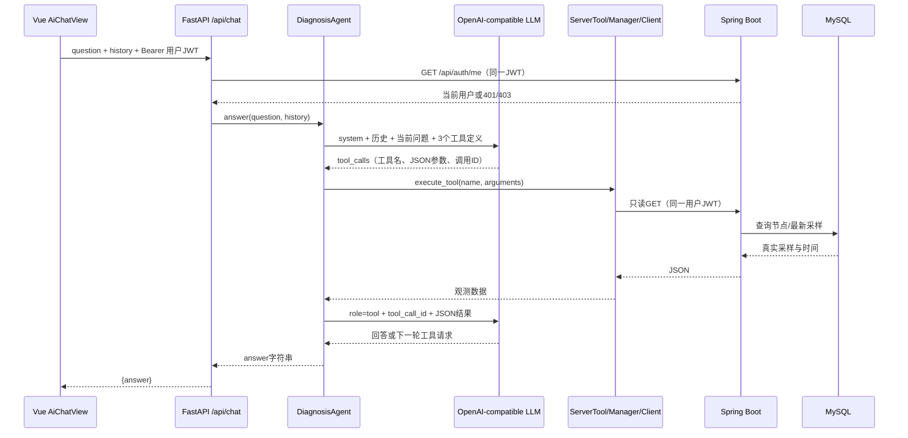

# 阶段 A 源码学习指南

## 1. 先理解三个概念

采集 Agent 和诊断 Agent 是两种程序：前者在被管理服务器采集实际资源，后者在中心服务组织模型与只读工具调用。
用户 JWT 是登录后读取平台的凭证；Agent credential 是采集端上报凭证，不能相互替代。
`server_id` 是 `ops_node.id`，不是旧原型 `agents.id`，也不是 GPU 编号。

本阶段唯一的正式主机采样来源是 Python Agent → Java → `metric_host_sample`。
AI 不采集自己机器的 CPU/GPU，不保存另一套监控数据库。

## 2. 建议阅读顺序

1. 阅读 `docs/stage-a-report.md`，先看哪些功能实际验过、哪些还没验。
2. 阅读 `agent/ai-service/tests/test_chat.py` 的 `test_three_tools_and_followup_use_real_http_contract`，理解完整输入与输出。
3. 阅读 `frontend/src/views/AiChatView.vue`，找到输入框、发送按钮和错误展示。
4. 阅读 `frontend/src/composables/useAiChat.ts`，理解历史消息如何形成、失败请求为什么不直接加入成功历史。
5. 阅读 `frontend/src/api.ts` 与 `frontend/vite.config.ts`，确认 JWT 请求头和 FastAPI 代理。
6. 阅读 `agent/ai-service/app/main.py` 和 `app/api/chat.py`，理解路由、认证和资源释放。
7. 阅读 `app/schemas/chat.py` 与 `app/config.py`，理解请求校验和环境变量。
8. 阅读 `app/agents/diagnosis_agent.py`，从 `answer()` 开始，接着看 `execute_tool()`。
9. 阅读 `app/tools/server_tool.py` → `server_manager.py` → `app/client/platform_client.py`，找到真正的 HTTP 请求。
10. 阅读 `app/llm/client.py`，理解模型接口与工具定义的作用。
11. 阅读 Java `security/SecurityConfig.java`、`JwtAuthenticationFilter.java`、`JwtService.java`，理解权限边界。
12. 阅读 `controller/ServerController.java`、`ServerMetricController.java`、`service/impl/ServerServiceImpl.java` 与 Repository/Entity。
13. 最后阅读 `agent/aiops_agent/__main__.py`、`snapshot.py`、`collectors/system.py`、`collectors/gpu.py`，追溯数据从哪来。

不要同时阅读所有文件。先追一个问题“服务器 1 的 CPU 怎么样”，再追一次“那内存呢”。

## 3. 一次提问如何跨文件运行

`tool_calls` 只是模型提出“想调用哪个函数”的数据，不会自动执行。
执行权在我们自己的 `handlers` 白名单；没有 `eval`、Shell 或任意 URL 工具。

## 4. Vue 的职责和函数输入输出

| 文件/函数 | 输入 | 输出或影响 |
| --- | --- | --- |
| `AiChatView.vue` | Pinia 登录状态、输入框内容 | 安全文本渲染、发送/取消/新建会话的操作入口 |
| `createChatRequest(question, messages)` | 当前问题、已完成历史 | 符合字符/条数限制的 `{question, history}` |
| `useAiChat(access, transport)` | 访问当前身份的函数、可注入请求函数 | 响应式 `input/messages/sending/error` 和 `send/cancel/reset` |
| `send(retry)` | 是否重试原失败请求 | 成功加入一对 user/assistant；失败保留问题供重试 |
| `cancel()` | 无 | 中止 AbortController；忽略迟到响应 |
| `reset()` | 无 | 取消请求，清空历史、草稿和错误 |
| `sendChat(request, signal)` | 请求体、取消信号 | `Promise<{answer}>` |
| `errorMessage(error)` | Axios 或普通异常 | 可展示的中文错误，包含 FastAPI `detail` |

`messages` 只有已完成的轮次。新问题单独放进 `question`，避免重复传两次。
取消请求后可能仍有网络响应到达；代码比较 AbortController 和用户身份，防止旧结果混入新会话。
模型文本用 `{{ item.content }}` 插值；不使用 `v-html` 执行模型给出的 HTML。
业务请求使用 `api`，AI 请求使用 `aiApi`；二者都加 JWT，但可以有不同的部署地址。

## 5. FastAPI 请求入口

| 类/方法 | 职责、输入和输出 |
| --- | --- |
| `create_app(settings, platform_factory, llm_factory)` | 建立 FastAPI 应用、路由和依赖工厂；测试可以替换 HTTP 适配器，生产默认使用真实客户端 |
| `Settings.from_env()` | 读取中心后端和模型设置，返回不可变 Settings；密钥不写入代码或 repr |
| `Settings.require_llm()` | 模型参数缺失时抛出配置异常，路由转成 503 |
| `HistoryMessage` | 只接受 user/assistant，拒绝额外字段、空白与过长内容 |
| `ChatRequest` | 问题 ≤4000、历史 ≤20 条、每条 ≤8000、总字符 ≤50000 |
| `chat(payload, request, credentials)` | 验证用户JWT，创建客户端，调用诊断并返回 ChatResponse |
| `PlatformClient.get_current_user()` | GET `/api/auth/me`，由 Java 验证签名、过期时间和用户状态 |

`HTTPBearer` 仅提取 Authorization，不验证 JWT 真伪。
本实现调用 Java 验证，避免 AI 服务复制 JWT 签名密钥和用户状态逻辑。
认证失败直接结束；已认证但没有模型配置返回 503。
`AsyncExitStack` 在正常结束、超时或异常时执行两个客户端的 `close()`。

旧拼写 `app/shcemas/chat.py` 仍可导入，但只转发到规范 `app/schemas/chat.py`，不存在第二套请求模型。

## 6. 模型与诊断 Agent

| 类/方法 | 输入 | 输出 |
| --- | --- | --- |
| `LLMClient(...)` | 用户配置的 model/base_url/api_key/timeout | 一个异步 OpenAI SDK 客户端 |
| `LLMClient.chat(messages, tools)` | 标准消息列表和工具 JSON Schema | SDK `ChatCompletionMessage`，可能含 content 或 tool_calls |
| `DiagnosisAgent.answer(question, history)` | 当前问题、历史 | 最终回答字符串；失败为明确异常 |
| `execute_tool(name, raw_arguments)` | 工具名、JSON 字符串 | 对应只读处理函数返回的数据 |
| `_tool_output(name, arguments)` | 工具调用 | `{"ok":true,"data":...}` 或 `{"ok":false,"error":...}` JSON 字符串 |

阅读 `answer()` 时注意顺序：固定 system → 历史 → 当前 user 问题。
收到工具请求后先保存 assistant 的 `tool_calls`，再为每个调用添加带同一 `tool_call_id` 的 tool 消息，最后再调用模型。
三个工具可以分两轮请求，也可以在同一轮中请求多个；每轮最多 3 个调用，总模型轮数最多 4。
工具参数只允许必要的 `server_id`，必须是正整数；Python 中 `bool` 也是 `int` 的子类，所以代码特意用 `type(value) is int`。
未知工具、错误 JSON、无采样会形成工具错误；401/403 直接中断，不让模型把未授权数据请求当作成功。

固定 system 提示会要求证据和采集时间，但提示词不能证明真实模型一定遵循。真实模型仍需配置后验收。
本阶段没有引入 LangGraph；复杂诊断状态机属于阶段 C。

## 7. 三层只读查询

| 层 | 类 | 为什么存在 |
| --- | --- | --- |
| 工具适配 | `ServerTool` | 对外暴露三个稳定 Python 函数名 |
| 业务转换 | `ServerManager` | 将平台 camelCase DTO 转为包含时间和单位的工具数据 |
| HTTP | `PlatformClient` | 统一 URL、JWT、超时、错误和连接释放 |

- `ServerTool.list_servers()` → `ServerManager.list_servers()` → `PlatformClient.get_server_list()` → Java `/api/servers`。
- `get_server_status(server_id)` → `get_server_snapshot(server_id)` → `get_server(server_id)` → Java `/api/servers/{id}`。
- `get_server_resource_usage(server_id)` → `get_resource_usage(server_id)` → `get_server_latest_metrics(server_id)` → Java `/metrics/latest`。

资源查询一次获取同一条采样，再拆 CPU、内存、磁盘，避免分别请求得到三个不同采集时刻。
`collected_at` 来自 Java `collectedAt`，不是 AI 服务生成的“现在时间”。
客户端检查返回的 `nodeId` 与请求 server_id 一致，不能把另一台机器的数据直接交给模型。
GPU 和集群接口未闭环时会明确报未实现，不能调用 AI 服务本机采集器补齐。

## 8. Spring Boot 与数据库

| 类 | 职责 |
| --- | --- |
| `SecurityConfig` | 用户API要求 ROLE_USER；Agent写入端点要求 ROLE_AGENT |
| `JwtService` | 签发和验证用户JWT，密钥从环境变量获得 |
| `JwtAuthenticationFilter` | 从JWT恢复当前用户身份，拒绝过期/伪造或已失效用户 |
| `AgentAuthenticationFilter` | 仅在Agent上报路径使用独立凭证 |
| `AuthController/AuthService` | 登录、当前用户、改密；已有注册草稿保留但不公开放行 |
| `ServerController/ServerServiceImpl` | 资产列表和详情及其最新指标摘要 |
| `ServerMetricController` | 按节点ID读取最新采样和时间范围历史 |
| `AgentAccessService` | 限时注册令牌、注册和采样写入，仍是正式节点采样链路 |
| `NodeRepository/HostMetricSampleRepository` | JPA 查询节点与 `metric_host_sample` |
| `MetricController/MetricServiceImpl` | 保留旧原型 Agent 指标接口，不与正式节点ID混用 |

Controller 处理 URL 与请求；Service 处理业务；Repository 查询数据库；Entity 表示数据库记录。
JPA 的 `ddl-auto=validate` 只核对结构，Flyway V1–V4 负责迁移。本阶段没有新增表。
`UserEntity.email` 暂不持久化；公开注册、邮箱迁移和更细的数据权限都未完成，不能从字段存在推断功能已上线。
旧 GPU 字段仍保留；没有新增 GPU 表或重新定义监控数据源。

## 9. 采集 Agent

`Agent.enroll()` 使用一次性 enrollment token 换取独立 credential 并写入本地状态文件。
`Agent.collect()` 调用 `HostSnapshot.get_snapshot()`，再把 system 的真实值组装为 Java 的 camelCase 上报请求。
`SystemCollector.collect_system_info()` 使用 psutil；`GPUInfo.get_gpu_info()` 使用可选 NVML，仅在采集端运行。
`Agent.run()` 在可中断重试循环中上报 `/api/agent/metrics` 和心跳。
本阶段没有把 GPU 快照写入数据库；现有 GPU 收集和进程脱敏代码保留，等待阶段 B 的上报契约。

## 10. 如何判断测试真的验证了什么

| 测试 | 实际范围 |
| --- | --- |
| `agent/ai-service/tests/test_chat.py` | 真实 FastAPI、Pydantic、SDK和工具循环；HTTPX模拟平台/模型响应 |
| `tests/live_smoke.py` | 真实 Java/MySQL、真实主机采样；模型仍为明确标注的 HTTP fixture |
| `frontend/tests/chat.test.mjs` | 请求上下文、取消/重试/身份变化、转义渲染与代理分流 |
| `MonitoringAccessTests` | 真实 Spring Security/JPA，使用 H2；验证多种无效凭证和正式上报读取 |
| `MetricControllerTests/MetricServiceTests` | 原型历史、详情、GPU字段保留与未实现集群的501响应 |

建议先运行一个测试，再给相应函数加断点。不要把“模拟模型返回 tool_calls”理解成“真实模型已学会诊断”。
真实模型验收时需要观察它是否主动调用工具、是否引用真实采集时间，以及面对无数据时是否明确说明。

## 11. 本次涉及的知识点

- Python：包相对导入、类型注解、dataclass、字典白名单、JSON编解码、异常分类、async/await、异步资源释放。
- FastAPI：APIRouter、Depends、HTTPBearer、Pydantic约束、响应模型、应用工厂、ASGITransport测试。
- 模型协议：Chat Completions消息角色、工具JSON Schema、tool_calls和tool_call_id、有限循环与超时。
- Spring Boot：MVC路由、Spring Security角色校验、JWT、事务、JPA查询和Flyway迁移。
- Vue：ref/computed、组合式函数、Pinia身份状态、AbortController、HTML文本转义与Vite代理。
- Agent：注册凭证和用户JWT分离、真实采样、采集时间与接收时间分离、断网重试。

协议格式参考：[OpenAI Docs Function Calling](https://developers.openai.com/api/docs/guides/function-calling)。
本工程保留兼容接口和现有手写循环，未切换到其他模型API或执行框架。
